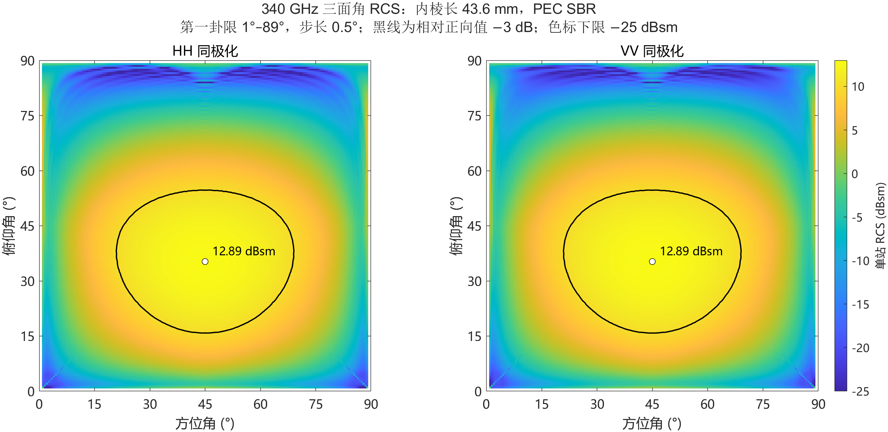
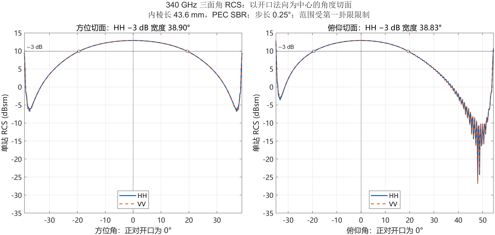

# 340 GHz 三面角反射器 RCS · MATLAB SBR

用 MATLAB 计算内棱长 **43.6 mm** 的三角形三面角反射器在 **340 GHz** 下的远场单站 RCS，并提供 HH/VV 方位—俯仰方向图、局部角度切面、原始数据和数值验证。

The solver combines geometrical-optics ray reflections with coherent vector Huygens integration over the exit aperture of a PEC triangular trihedral. This is a **high-frequency approximation**, not a full-wave solver or a measured calibration result.

## 结果

| 项目 | 数值 / 条件 |
|---|---|
| 频率 | 340 GHz |
| 内棱长 | 43.6 mm，每块直角等腰三角形板的直角边 |
| 材料与几何 | 零厚度 PEC，三面严格正交且连接 |
| 正向单站 RCS | **19.47 m² / 12.89 dBsm**，HH 与 VV 一致 |
| HH 局部方位 −3 dB 宽度 | **约 38.9°** |
| HH 局部俯仰 −3 dB 宽度 | **约 38.8°** |
| 二维扫描 | 方位、俯仰各 1°–89°，0.5° 步长，共 31,329 个方向 |
| 角度切面 | 0.25° 步长 |
| 已运行环境 | MATLAB R2023b |

以上宽度以开口法向为局部 0°。二维热图采用内棱定义的全局坐标：正向为方位 **45°**、俯仰 **35.26438968°**。两种坐标不可混用；详见[计算说明](results/PATTERN_README.txt)。





[三维 HH 方向图](results/rcs_3d_HH.png) · [详细说明](results/PATTERN_README.txt) · [CSV 数据](results/rcs_azimuth_elevation.csv) · [MAT 数据](results/rcs_pattern_data.mat)

## 运行

在仓库根目录打开 MATLAB：

```matlab
addpath('src');

% 单个方向，无需 Antenna Toolbox 或并行池
r = sbr_pattern_exit(43.6e-3, 340e9, 45, asind(1/sqrt(3)), 768);
fprintf('HH = %.6f dBsm\n', 10*log10(r.HH));

% 从仓库已有数据重画热图、三维图及全局切面
plot_pattern_sweep;

% 完整扫描、验证与绘图（使用 Parallel Computing Toolbox，4 个进程）
run_pattern_sweep;
```

核心求解只使用 MATLAB 基础数值运算。完整扫描脚本需要 Parallel Computing Toolbox；可在没有该工具箱时逐点调用 `sbr_pattern_exit`。输出写入 `results/`，本地检查点和日志不纳入版本控制。

复核可移植性与主要数值：

```matlab
addpath('tests');
smoke_test;

% 可选：用原始逐步求交追踪器核对出射口可见性和传播相位
validate_exit_sampling;
```

## 方法与数值验证

最终入口是 [`sbr_pattern_exit.m`](src/sbr_pattern_exit.m)：在出射口均匀采样，对每个可能的反射分支反向追踪可见性，保留 PEC 极化变换与传播相位，再相干叠加远场。积分包含可见的一次、二次和三次反射分支。方向图没有用解析 RCS 公式替代，也没有做删峰或平滑。

二维图每个角度使用 147,456 个孔口点，切面使用 589,824 个；一个孔口点可能对应多个出射分支。加密验证使用 2,359,296 个孔口点。

- 在 **97 个抽查角度**中，加密后正向值以下 3 dB 区域的最大变化约 **0.016 dB**，全部抽查点最大变化约 **0.078 dB**。
- 对最高的 **12 个网格候选角度**另行加密，最大变化约 **0.012 dB**。粗网格的 12.9015 dBsm 不能据此解释为真实峰值抬升。
- [验证数据](results/ray_density_validation_exit.csv)、[峰值检查](results/peak_validation.csv)和[最终汇总](results/summary.json)随仓库提供。

入射口面积加权采样在某些近掠射出射分支处会出现采样伪峰。仓库保留相关诊断实现，以复核[两种采样的差异](results/entrance_exit_sampling_comparison.csv)；**广角方向图应使用 `sbr_pattern_exit`，不要直接使用诊断用的 `sbr_pattern_point` 或 `sbr_trihedral`**。正向结果未受该问题影响。

## 范围与限制

当前模型仅覆盖 **sₓ、sᵧ、s_z 均为正的第一卦限**；未计算背面、完整球面及精确边界掠射。未绘制区域不代表零 RCS。

模型未包含有限电导率、粗糙度、板厚、装配误差、支架、环境多径，以及显式 UTD/PTD 物理边缘绕射。孔口相干积分中的有限孔径干涉，不等于完整边缘绕射。上述数值加密检查也不构成相对于全波解或实测值的误差界。

热图和三维图的色标下限为 −25 dBsm，原始数据没有截断。三维图半径为 `sqrt(sigma/sigma_max)`，颜色为绝对 RCS；它的坐标不是反射器尺寸。

## 文件

- `src/`：稳定求解器、扫描与绘图脚本、诊断对照程序。
- `tests/`：公开版本的基础复现检查。
- `results/`：最终 PNG、可编辑 FIG、切面 SVG、CSV/MAT 数据、计算说明及验证表。
- `MANIFEST.sha256`：仓库内容的逐文件校验值，不包含该清单自身。

## 方法参考

Baldauf et al., *High frequency scattering from trihedral corner reflectors and other benchmark targets: SBR versus experiment*, IEEE Transactions on Antennas and Propagation, 1991. [DOI: 10.1109/8.99043](https://doi.org/10.1109/8.99043) · [NASA 书目与摘要](https://ntrs.nasa.gov/citations/19920033685)。

三角形三面角的内棱定义与正向理论参考：[*Dielectric corner reflectors for mmWave applications*, Section 2, Eq. (1)](https://ars.copernicus.org/articles/17/197/2019/)。文献中的实验结果不作为本代码已经过实验验证的依据。
